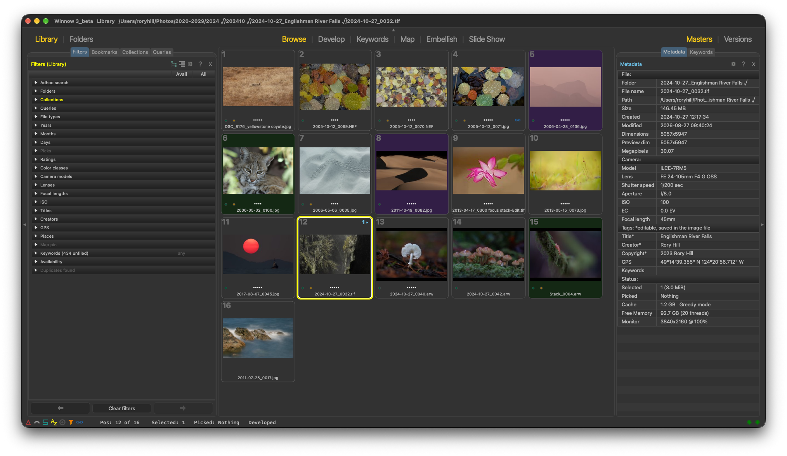
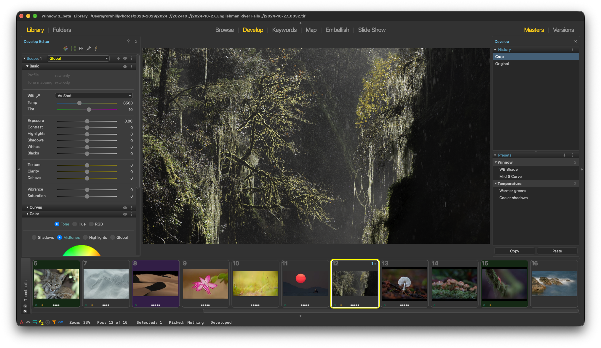
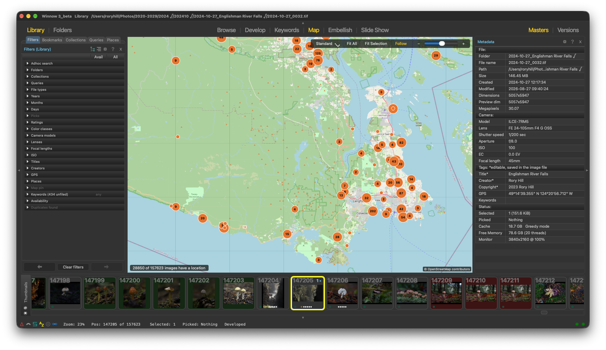

# Winnow

**Fast image browsing, culling and editing for macOS and Windows.**

Winnow started as a tool for one job: getting through a full memory card quickly, picking
the keepers, and copying them to your computer. It still does that job well, and it now
also has a library, keywording, a map, a raw developer and focus stacking.

**You choose how you work: Library or Folders.** You never have to import anything or
manage a library to use Winnow.

- **Folders:** open any folder, memory card or drive and start viewing, culling and
  editing right there. Your files stay where they are, organised the way you organised
  them.
- **Library:** when you want it, a catalog indexes your choice of folders so you can
  search, filter and keyword across your whole collection at once.

Switch between the two with one click. The Library is there when it helps, never
required.

## Download

Get the latest version from the
[Releases page](https://github.com/towhee/Winnow64/releases/latest).

| Platform | File | Requirements |
|---|---|---|
| macOS | `Winnow<version>.dmg` | Apple Silicon (M1 or later), macOS 12 or later |
| Windows | `WinnowSetup-<version>.exe` | 64-bit Windows 10 or 11 |

**macOS:** open the DMG and drag Winnow into Applications. The app is signed and
notarized by Apple.

**Windows:** run the installer. The installer is not code-signed yet, so Windows
SmartScreen may show a warning. Click **More info → Run anyway**.

> Winnow 3 is in **beta**. Back up your images before trying any feature that writes
> files.

## Features

### Ingest and cull
- Browse a memory card or folder at full speed. Images are cached ahead of you, so
  moving to the next image is immediate.
- Pick, reject, rate and colour-label with single keys, then copy only the picks to your
  computer, renamed and filed into folders by a template.
- **Pan to focus:** zoom in to check focus, and as you move from image to image Winnow
  pans straight to the subject (an eye, for example), so you see the critical detail
  without dragging around each image. A machine learning model predicts where to look.
- Thumbnail grid, loupe, side-by-side compare and table views.

### Library (optional)
- Nothing to import: the Library is an index over the folders you already have, and
  everything else in Winnow works without it.
- Catalogs index your choice of folders, so you can search and filter hundreds of
  thousands of images without reopening folders.
- Filter by date, camera, lens, focal length, ISO, rating, colour class, keywords, GPS
  and more. Combine filters with Collections and saved Queries.
- Hierarchical keywording with drag-and-drop filing.
- **Versions:** virtual copies, so one master can have several developed looks.

### Develop
- Non-destructive raw and image editing: white balance, exposure, tone, curves, colour
  grading, point colour, texture, clarity, dehaze, lens corrections, crop and
  perspective.
- Local adjustments with masks: brush, linear gradient, luminance and colour range, plus
  AI masks for subject, sky, background, depth and individual objects.
- AI models install automatically, just in time: each one downloads the first time you
  use a tool that needs it, so the app download stays small.
- Spot removal, presets, copy and paste of settings across a selection, and a full edit
  history.
- Edits are saved in sidecar files. Your original images are never changed unless you
  allow it.

### Map
- See where your images were taken on an OpenStreetMap map, with clustered pins.
- Filter the library by a map region, and drag images onto the map to geotag them.

### Also included
- **Focus stacking** to combine a series of shots into one sharp image.
- **Embellish** for borders, text and graphics on exported images.
- **Slide show.**

## Screenshots

**Browse:** library filters, the thumbnail grid and metadata.


**Develop:** global and masked adjustments, presets and history.


**Map:** every geotagged image in the library, clustered by location.


## Building from source

Winnow is C++20 with Qt 6, built with CMake.

**Dependencies:** Qt 6 (Core, Widgets, Multimedia, Concurrent, Svg, Network, Sql),
OpenCV 4, ONNX Runtime, FFmpeg and libwebp. On macOS, install the libraries with
Homebrew (`brew install opencv onnxruntime ffmpeg webp`).

```sh
cmake --preset mac-release        # or win-release on Windows
cmake --build --preset mac-release
```

Debug presets are also available (`mac-debug`, `win-debug`). To run the tests:

```sh
ctest --test-dir build/<preset> --output-on-failure
```

See [`tests/README.md`](tests/README.md) for details. Packaging, signing and publishing
are covered in [`packaging/README.md`](packaging/README.md).

AI models are not stored in git. A source build downloads them automatically, the first
time a tool needs one, just like a released build.

## Feedback

Report bugs and request features on
[GitHub Issues](https://github.com/towhee/Winnow64/issues).

More information: [winnow.ca](http://winnow.ca)

## License

Winnow is free software, licensed under the
[GNU General Public License, version 3 only](LICENSE) (GPL-3.0-only).

Winnow builds on Qt, OpenCV, ONNX Runtime, libjpeg-turbo, LibTIFF, Little CMS, LibRaw,
ExifTool, the lensfun lens database and other open-source projects. The downloadable AI
models keep their upstream licenses. See [THIRD_PARTY_NOTICES.md](THIRD_PARTY_NOTICES.md)
for the full list and the [licenses](licenses) folder for the license texts.
